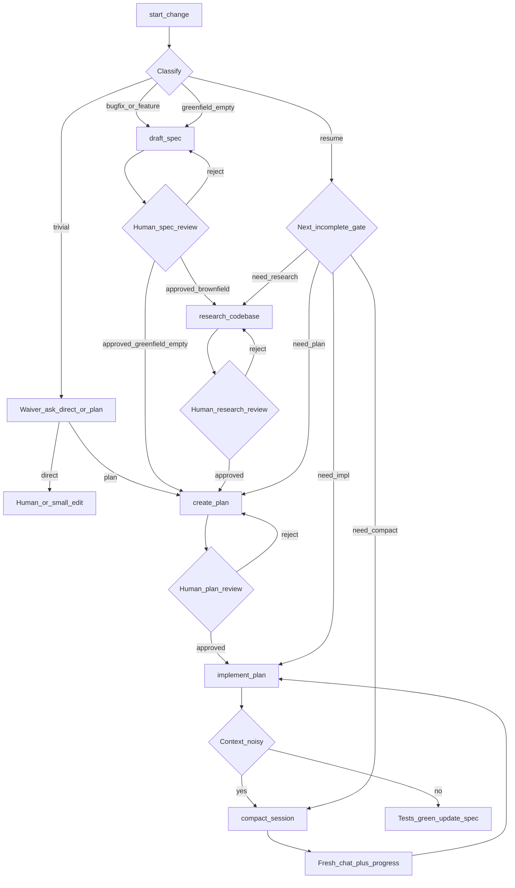

# Когда какую команду вызывать

Вход почти всегда: **`start-change`** / `/start_change`.  
Дальше — по классу изменения и human gates.

## Граф решений

## Таблица «ситуация → путь»

| Ситуация | Класс `start-change` | Цепочка |
|----------|----------------------|---------|
| Опечатка, bump deps, docs | `trivial` | waiver → патч или короткий `create-plan` |
| Баг в существующем коде | `bugfix` | `draft_spec` → **research** → `create_plan` → `implement_plan` |
| Новая фича в brownfield | `feature` | то же, full SDD+ACE |
| Новый репо, кода почти нет | `greenfield-empty` | `draft_spec` → `create_plan` (research waive) → `implement_plan` |
| Уже есть spec/plan, продолжаем | `resume` | следующий незакрытый gate |
| Сессия раздулась | — | `compact_session` → новый чат |

## Игрушечный пример (brownfield-фича)

Репо уже с ace-sdd. Задача: *«добавить фильтр `GET /issues?assignee=`»*.

### 1. Старт

**Cursor:** skill `start-change`  
**Claude:** `/start_change`

Ты: *«Фича: фильтр issues по assignee в нашем API.»*

Агент:

- класс: `feature`
- пишет `thoughts/shared/progress/2026-10-28_route_assignee-filter.md`
- **в этом же ходе** только `draft_spec` → `docs/specs/2026-10-28_assignee-filter.md`
- **стоп** — «проверь spec-review»

### 2. Ты

Чеклист `harness/checklists/spec-review.md` → ставишь `Status: approved`.

### 3. Research

**Cursor:** `research-codebase`  
**Claude:** `/research_codebase`

*«Spec: docs/specs/2026-10-28_assignee-filter.md — исследуй.»*

Агент → `thoughts/shared/research/...md` → **стоп**.

### 4. Ты

`research-review.md`. Ок.

### 5. Plan

`create-plan` / `/create_plan` → `thoughts/shared/plans/...md` с фазами и `go test ./...` → **стоп**.

### 6. Ты

`plan-review.md`. Ок.

### 7. Implement

`implement-plan` / `/implement_plan`  
*«План: thoughts/shared/plans/….md»*

Фазы + тесты. Если шум — `/compact_session`, новый чат с progress-файлом, снова `implement-plan`.

### 8. Финиш

Тесты зелёные; в spec `Status: implemented` если поведение совпало.

---

## Игрушечный пример (trivial)

Ты → `/start_change`: *«В README опечатка Harness→Harness.»*

Агент: класс `trivial`, route note с  
`waiver: no-spec — docs-only`, спрашивает direct patch.  
Ты: *«да, правь»* — обычный edit **без** research (это уже не start-change).

---

## Игрушечный пример (баг)

Ты → `start-change`: *«PATCH принимает open→done.»*

Класс `bugfix` → короткий spec (или acceptance в issue) → обязательно **research** (dual paths!) → plan → implement.

## Чеклист «не вызывай impl слишком рано»

- Нет approved spec (и нет waiver)? → не `implement-plan`
- Brownfield и нет research? → не `create_plan` / не impl
- Нет verify-команд в plan? → отвергни plan
